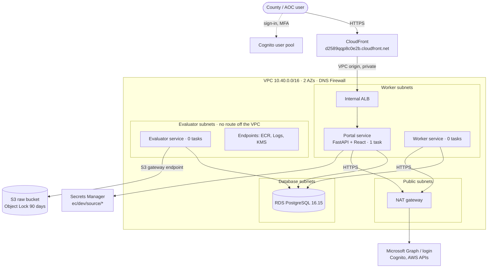

# Deployment status: dev

As of **19 October 2026**. The dev environment of the Evidence Collector / Court Connection
Readiness (CCR) platform runs in AWS account **555509860132** (`dbiz-edr-solutions`, us-east-1).
**168 resources**, all in Terraform; a plan after the last apply shows no changes. Phase 1 of the
application (foundation and onboarding) is live at **https://d2589qqp8c0e2b.cloudfront.net**.

| | |
|---|---|
| AWS account | 555509860132 `dbiz-edr-solutions` (Control Tower managed), region us-east-1 |
| Environment | `dev` (prod not built) |
| Portal | https://d2589qqp8c0e2b.cloudfront.net (Cognito sign-in, MFA required) |
| Infrastructure repo | [nkgpamukuntla/evidence-collector](https://github.com/nkgpamukuntla/evidence-collector), branches `core-infra` → `portal` (not yet merged to `main`) |
| Application repo | [nkgpamukuntla/ccr-platform](https://github.com/nkgpamukuntla/ccr-platform), `main` |
| Deployed image | `ec-dev-collector:894ad7259c12` = ccr-platform commit `894ad72` |
| Terraform | 1.16.3, AWS provider 6.65.0; state in `ec-dev-tfstate-555509860132` (KMS-encrypted, versioned, locked) |
| Deploy model | From a workstation with the `edr-dev` SSO profile; no CI pipelines |

## Architecture



The ALB has no public address: CloudFront reaches it through a VPC origin. Only the worker
subnets have a route out (through NAT), and DNS Firewall limits names to Microsoft, AWS and
Cognito. The evaluator subnets have no route off the VPC (R6).

## Infrastructure

### Account level (`infra/bootstrap`, 23 resources)

| What | Name | Purpose |
|---|---|---|
| CloudTrail (multi-region) + log bucket | `ec-dev-trail`, `ec-dev-cloudtrail-555509860132` | Makes every key-policy change visible (R4); logs kept 365 days |
| Terraform state bucket + KMS key | `ec-dev-tfstate-555509860132`, `alias/ec-dev-tfstate` | Remote state, encrypted, versioned (old versions 90 days), access limited to named principals |
| KMS-change alert | EventBridge `ec-dev-kms-changes` → SNS `ec-dev-security-alerts` | Alerts on PutKeyPolicy, CreateGrant, ScheduleKeyDeletion, DisableKey |
| Break-glass key admin | IAM role `ec-dev-key-admin` | Second key administrator with a stable ARN, so an SSO re-provision cannot orphan keys |

### Environment (`infra`, 145 resources in 9 modules)

| Module | What is deployed | Resources |
|---|---|---|
| network | VPC 10.40.0.0/16; 8 subnets (evaluator, public, worker, db × 2 AZs); 1 NAT gateway (IP 98.95.45.7) and internet gateway; S3 gateway endpoint; interface endpoints `ecr.api`, `ecr.dkr`, `logs`, `kms`; 10 security groups; Route 53 DNS Firewall allowlist | 73 |
| compute | ECR `ec-dev-collector` (immutable tags, keeps 10); ECS cluster `ec-dev-cluster`; services portal (1 task), worker (0), evaluator (0); task definitions incl. one-off `ec-dev-db-bootstrap`; log groups (14 days) | 19 |
| portal | Internal ALB `ec-dev-portal`; CloudFront distribution + VPC origin; Cognito user pool `us-east-1_kqdH8nnJo` (MFA on, admin-created users only), domain, app client (code + PKCE, no secret), groups `platform_admin`, `aoc_viewer`; initial admin user | 13 |
| build | ARM CodeBuild project `ec-dev-app-build`; source bucket `ec-dev-build-src-555509860132` (zips expire after 7 days); build role and logs | 10 |
| identity | Roles `ec-dev-worker`, `ec-dev-evaluator`, `ec-dev-terminator`, `ec-dev-portal` and their policies | 8 |
| raw-bucket | `ec-dev-raw-555509860132`: Object Lock (governance, 90 days), versioned, private, tenant-key policy | 8 |
| kms | Signing (RSA-2048, RS256 only), fingerprint (HMAC-256) and secrets keys with aliases; no tenant keys until tenant ids are added | 6 |
| database | RDS `ec-dev-pg`: PostgreSQL 16.15, db.t4g.micro, 20 GB gp3, encrypted (aws/rds), private, force SSL, IAM auth; IAM connect policies | 6 |
| liveness | SNS topic `ec-dev-liveness`; heartbeat alarm off until R10 allows | 2 |

## Application: Phase 1 foundation

Repository [ccr-platform](https://github.com/nkgpamukuntla/ccr-platform): Python 3.12 / FastAPI
API and React 18 / Vite / TypeScript portal, one linux/arm64 image.

| Area | Delivered |
|---|---|
| Sign-in | Cognito hosted sign-in, MFA required; ID token verified against the pool's keys on every request; HttpOnly secure cookie |
| Roles | `platform_admin` (all), `aoc_viewer` (aggregate, read-only), office admin/member (own office only) |
| Tenancy | Governed offices (consent is per office), email-keyed membership, site register (sample sites until the 264-site list is supplied) |
| Onboarding wizard | 1 Organisation and sites · 2 Environment profiler (profiles A–E, Connect/Import/Collect path, live preview) · 3 Role-tagged prerequisites · 4 Consent records and write-only credential vault · 5 Import/Collect placeholder · 6 Readiness check and go-live |
| Vault | Source credentials go to Secrets Manager `ec/dev/source/<office>/<source>`, encrypted with the secrets key; the portal can write but not read them (R5) |
| Audit | Append-only log (trigger + grants) of every change, shown per office |
| AOC view | Offices, live count, site coverage, offices by profile |
| Database | Plain SQL migrations (`0001_foundation`, `0002_seed_sites`) applied by the db-bootstrap task; runtime role `ec_portal` with least-privilege grants and no password (IAM auth) |
| Tests | 18 (profiler rules, end-to-end onboarding on PostgreSQL 16 as `ec_portal`, grants, append-only audit, dev-auth guard); ruff and mypy strict clean |

Posture, Findings, Remediation and Evidence pages are placeholders that name their build phase.

## Verification on 19 October 2026

| Check | Result |
|---|---|
| `terraform plan` (bootstrap and infra) | No changes |
| `GET /healthz` through CloudFront | 200 |
| `GET /api/me` without a session | 401 |
| `GET /auth/login` | Redirect to Cognito with PKCE |
| Migrations | 2 applied, task exit code 0 |
| ALB target | Healthy |
| Signed-in journey in AWS | Not yet run (needs the admin's first sign-in and MFA setup) |

## How the rules are held

| Rule | How it holds in what is deployed |
|---|---|
| R1 New account, separate from PRISM | Dedicated account; nothing from PRISM. Read-only scanner roles `PRISM-ReadOnly` and `ProwlerScan` pre-existed (Control Tower) |
| R2 Everything through Terraform | All 168 resources; no console changes |
| R3 No private key on disk | Signing key is a non-exportable KMS RSA-2048 key |
| R4 Key policy is the only authority | No root delegation, no `kms:CreateGrant` in any key policy; admins manage, never use; CloudTrail + alert on policy changes |
| R5 Credentials never through Terraform | Written by the portal straight to Secrets Manager; DB master password managed by RDS; app DB login by IAM token |
| R6 Evaluator has no internet | Evaluator subnets: local route + S3 gateway endpoint only; SG egress S3, KMS, Postgres, ECR/Logs endpoints |
| R8 Graviton | All tasks ARM64; image built on an ARM CodeBuild host |
| R9 PostgreSQL 16 | 16.15, auto minor upgrade off |
| R10 Deadman not before the entry point | Liveness alarm deployed off; worker at 0 tasks |
| R11 Database is not tenant isolation | Office scoping in the application; grants are the boundary |

## How to deploy a change

```powershell
$env:AWS_PROFILE = "edr-dev"
$tf = "C:\Dbiz-Projects\AOC\tools\terraform-1.16.3\terraform.exe"

# Application: build the committed HEAD in CodeBuild (no local Docker)
cd C:\Dbiz-Projects\AOC\ccr-platform
.\scripts\build-image.ps1 -Environment dev          # prints the image tag

# Infrastructure: record the tag, plan, review, apply the saved plan
cd C:\Dbiz-Projects\AOC\evidence-collector\infra
Set-Content envs\dev.image <tag>
& $tf plan -var-file=envs/dev.tfvars -out=dev.tfplan
& $tf apply dev.tfplan

# New migrations: run the one-off task in the worker subnets with the db-bootstrap security group
aws ecs run-task --cluster ec-dev-cluster --task-definition ec-dev-db-bootstrap --launch-type FARGATE `
  --network-configuration "awsvpcConfiguration={subnets=[<worker subnets>],securityGroups=[<db-bootstrap sg>],assignPublicIp=DISABLED}"
```

`envs/dev.tfvars` is local only (never committed). Tools need no admin rights: Terraform and
Node are portable copies under `C:\Dbiz-Projects\AOC\tools`, uv is a user-level install.

## Cost (dev)

| Item | Approx. USD per month |
|---|---|
| NAT gateway | 33 + data |
| Interface endpoints (4, one AZ) | 29 |
| ALB | 18 |
| RDS db.t4g.micro + 20 GB | 14 |
| Portal task (0.25 vCPU, 0.5 GB, ARM) | 9 |
| KMS keys (4) | 4 |
| CloudFront, Cognito, CloudWatch, DNS Firewall, S3, CodeBuild | under 10 |
| **Total** | **about 110 to 125** |

Approximate us-east-1 list prices, not a quote. Log retention: CloudWatch 14 days, CloudTrail
365 days, state versions 90 days, build sources 7 days.

## Open items

| Item | Owner |
|---|---|
| Merge `core-infra` and `portal` into `main` (infra repo) | Naresh |
| First sign-in and walk-through of the wizard in AWS | Naresh |
| Database key: AWS-managed `aws/rds` (Option B) vs customer key (Option A) | Tim |
| D7: home tenant for the Microsoft app registration | Tim |
| Microsoft test tenant (E5 developer) for Phase 2 | Naresh |
| Full 264-site register | AOC via Tim |
| Pin base images by digest; CloudFront WAF before any real county data | Naresh |
| External deadman monitor and paging destination | Naresh |
| Prod account and environment | Naresh, after Phase 2 |

**Next: Phase 2, Microsoft path:** real admin-consent sign-in, KMS-signed certificate, Graph and
Intune collection by the worker, and the Posture page on live tenant data.
